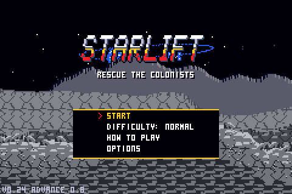

# StarLift Advance

STARLIFT, the lander-rescue game made for the CHGame handheld, redrawn for the whole Game Boy Advance screen:
240x160, pixel for pixel, nothing stretched. Version **FS 0.8**, from the CHGame version 0.24 (merged in with its bosses,
chrome title, cut-scenes and balance changes).

The CHGame version (128x128) stays in its own repository; this one has its own copy of the game in `game/` and the GBA
back end in `gba/`.

## What is different on the GBA

- **The whole screen.** The game draws 240x160 itself: a wider view of each world, the world lower on the screen, a
  taller HUD with a full-width radar, and more sky. Menus and panels keep their layout, centred.
- **A smooth sky.** The sky's dithered bands are replaced by a gradient the GBA paints itself, a colour each screen line
  (colour 0, the sky's top colour, is the one the hardware shows through; an HBlank DMA changes the backdrop per line).
- **See-through tractor beams.** The beam is drawn into hardware sprites that the GBA blends over the scene.
- **Fades** in from black on the title, each stage card and the game over; the picture **breaks into blocks** for a
  moment when the lander is lost (the GBA's mosaic).
- **Shoulder buttons.** L puts the landing gear up or down in one press; R works as UP (hold it to charge the shot).
  The original controls all still work.
- **More sparks**: twice the particles, bigger explosions.
- **A soft echo** on the music and effects (125 ms, about a quarter level). `GBA_ECHO=0` builds without it.
- Scenery pictures come straight from the cartridge (the "SD card" file is in the ROM), so none ever waits a frame.
- **The ground on its own hardware layer**: drawn once as it scrolls into view (the hardware scrolls it), with detail the
  picture never had time for: pebbles in the soil, lit on top with a shadow under.

## Controls

D-pad left/right: tilt. A: main engine. B: cannon and laser. Hold UP (or R): charge shot. DOWN twice (or L): landing
gear. START: pause menu (hold 3 s: start over).

Remapping: OPTIONS > CONTROLS on the title screen, or hold L + R + SELECT at any time, for the CONTROLS screen. Any control (the eight buttons, the gear and the
charge shot) can go on any GBA key: UP/DOWN to choose, A then the new key, B or DONE to leave. Kept in the save RAM.

## Building

    python gba/build.py          ->  gba/out/STARLIFT.gba

zig is the only compiler needed (the game, the vendored CHGame library and the GBA back end are compiled with zig c++
for the ARM7TDMI). `build.py` copies `game/`, regenerates its card file (`game/tools/make_card.py`), applies
`gba/patches/*.patch` (GBA-only speed-ups, each checked to apply exactly once) and links the ROM; STARLIFT.DAT is
appended to it. See `gba/README.md` for the back end and its build notes.

Switches (environment): `GBA_CFLAGS="-DSL_START=n"` starts new games at stage n; `GBA_SKETCH_THUMB=1` builds the game
code as Thumb; `GBA_SCENECHECK=1` draws the scenery and every picture both the game's way and the patched way each
frame and counts differences (`gba/tools/frames.py` reports them).

## Tested

In mGBA (nightly), on a fixed 3000-frame scripted run (`gba/tools/frames.py`: title, stages, crashes, game over and back)
and a 1500-frame run starting on each of the 8 worlds: no crash. A check build compared the game's own scenery and
picture drawing with the patched versions (no difference in 12,000 scenery and 44,000 picture draws, FS 0.2), and the
ground layer with the picture's own ground pixel for pixel (no difference in 3000 frames, FS 0.3; the pebbles are new
since).

**Speed (FS 0.8, latest run, 3000 scripted frames from a fresh save):** the typical frame takes 21-26 ms of the 33.3 ms
budget, and 58 of 2998 frames went over (about 2%): the title (first frame 275 ms), the stage builds (about 225-260 ms), and
short runs of 34-100 ms at explosions and scene cuts (frames 1031-1110, 2200-2260, 2673-2678). So it holds 30 fps in play;
the hitches are the stage loads and the busiest explosions. Costs: a 240x160 picture is 2.3 times the board's pixels, held in
the GBA's slower EWRAM and copied to video memory every frame (3.1 ms).

Not tried: a real GBA. The MiSTer GBA core: FS builds up to 0.1 were played there; 0.2-0.4 have not been tried yet.
The sound (including the echo) has not been listened to; its levels were checked (no clipping).

## Credits and licences

Game, art and music by Jadflat (MIT, see LICENSE). Built on CHGame by Kevin Bates (Apache-2.0, `game/chgame/`,
see its LICENSE and NOTICE). See `game/THIRD-PARTY.md` for the sound output's credit.
